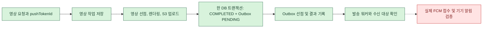
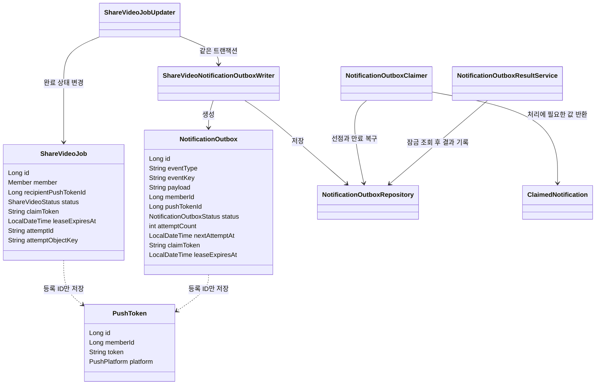
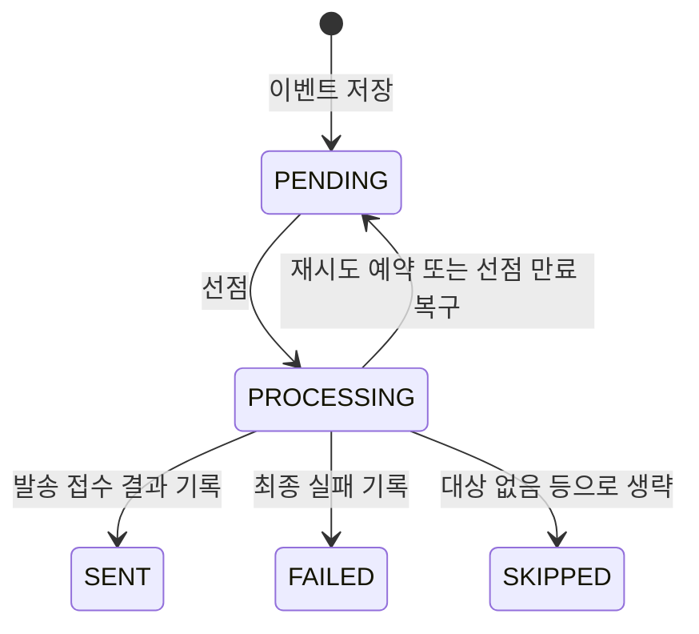

# 알림 Outbox 팀 가이드

> 기준: 2026-10-30 로컬 작업 트리. 배포·운영 DB 반영 여부는 확인하지 않았다.
> 현재 영상 완료와 Outbox 저장 및 선점·결과 기록 메서드가 구현되어 있다. **영상 알림 발송 워커와 FCM 호출 코드는 로컬에 연결했다. 실제 Firebase 인증·실기기 수신은 아직 검증하지 않았다.** 그룹 앨범은 기존 `AlbumPushListener` 경로를 사용하며 이 Outbox에 연결되지 않았다.

[ERD](erd.md#알림과-영상-작업-현재-스키마) · [ADR 0026](adr/0026-shared-notification-outbox.md) · [기기 등록 API](share-video-notification.md)

## 왜 필요한가

영상은 앱과 별도로 서버에서 생성된다. 완료 상태를 DB에 저장한 후 FCM을 호출하기 전에 서버가 종료되면 알림을 잃을 수 있다. 반대로 DB 커밋 전에 FCM을 호출하면 DB는 롤백돼도 알림이 발송될 수 있다.

따라서 한 DB 트랜잭션에 **영상 완료와 발송할 일(Outbox)**을 함께 저장한다. 추후 발송 워커가 커밋된 Outbox를 읽고 트랜잭션을 끝낸 뒤 FCM을 호출한다. Outbox는 기기 알림 수신을 보장하는 큐가 아니라, 서버가 발송할 일을 복구할 수 있도록 보관하는 기록이다.

## 전체 흐름

초록색은 구현, 노란색은 메서드만 구현, 빨간색은 미구현이다.

- `pushTokenId` 없이 요청하면 영상은 완료되지만 Outbox는 생성되지 않는다.
- `ShareVideoJobUpdater.completeClaimed()`가 현재 영상 선점 토큰을 확인하고, `ShareVideoNotificationOutboxWriter.save()`와 같은 트랜잭션에서 상태와 Outbox를 변경한다. 삽입이 실패하면 둘 다 롤백된다. S3 업로드는 롤백되지 않는다.
- 완료 기록의 일시적인 DB 오류는 현재 최대 세 번 즉시 재시도한다. 이건 **알림 발송 재시도**가 아니다.
- 서버 중단이나 세 번의 기록 실패 후 남은 영상 작업의 자동 복구는 미구현이며 영상 리팩토링에서 다룬다.

## 엔티티와 클래스

점선은 논리적 ID 참조이며 DB 외래 키나 JPA 엔티티 연관관계가 아니다. `PushToken`은 기존 엔티티이고 `NotificationOutbox`가 이번에 추가된 엔티티다. `ClaimedNotification`과 `ShareVideoCompletedPayload`는 값 전달용 record다.

| 이름 | 역할 |
| --- | --- |
| `PushToken` | 회원 ID, 플랫폼, FCM 등록 토큰을 보관한다. `id`는 등록 행의 ID이며 FCM 토큰 자체가 아니다. |
| `ShareVideoJob` | 영상 요청·생성 상태와 요청 당시 수신 등록 ID를 보관한다. 영상 워커의 선점과 생성 시도 정보도 가진다. |
| `NotificationOutbox` | 사건 하나를 등록 기기 하나에 보내기 위한 작업과 상태를 저장한다. FCM 토큰 원문은 저장하지 않는다. |
| `ShareVideoNotificationOutboxWriter` | `VIDEO_COMPLETED`, `video:<jobId>:completed`, `{"jobId":15}`를 생성한다. 외부 트랜잭션이 없으면 호출할 수 없다. |
| `NotificationOutboxRepository` | Outbox 저장과 잠금 조회를 담당한다. `SKIP LOCKED`는 이미 잠긴 항목을 건너뛴다. |
| `NotificationOutboxClaimer` | 대기 항목 하나를 5분간 선점하거나 만료된 항목 하나를 대기로 복구한다. 영상 발송 워커가 영상 이벤트에 한해 호출한다. |
| `ClaimedNotification` | 선점된 항목의 ID·토큰·유형·payload·수신 ID를 발송 단계에 전달하는 record다. |
| `NotificationOutboxResultService` | 행을 잠근 뒤 현재 선점의 결과를 기록한다. `false`는 행이 없거나 현재 선점이 유효하지 않다는 뜻이다. 영상 발송 워커가 호출한다. |
| `PushSender` / `LoggingPushSender` | 기존 그룹 알림 발송 인터페이스와 로그 구현체다. `LoggingPushSender`는 실제 FCM을 호출하지 않는다. |

### 식별자 예시

- `push_token.id=42`: 서버에 저장된 등록 행. 인증 토큰이 아니다.
- `push_token.token`: FCM이 발급한 수신 주소. 변경될 수 있으며 비밀값처럼 로그 노출을 피한다.
- `share_video_job.id=15`: 영상 작업을 식별한다.
- `notification_outbox.id=100`: 기기별 발송 작업 한 건을 식별한다.
- `event_key=video:15:completed`: 영상 15의 완료 사건을 식별한다. `UNIQUE(event_key, push_token_id)`는 해당 행이 보관되는 동안 같은 사건·등록 ID의 중복 저장을 막는다.
- `claim_token`: 특정 워커의 선점 시도를 구분한다. 영상 작업과 Outbox는 각각 별개의 토큰을 사용한다.

## Outbox 상태와 트랜잭션

영상 완료 알림은 선점·FCM 요청·결과 기록이 연결되어 있다. 현재 FCM 오류는 자동 재시도하지 않고 실패로 기록한다.

- `SENT`는 FCM이 접수했다는 의미로 설계했다. 기기 도착·표시·사용자 확인의 증거는 아니다.
- `attempt_count`는 현재 코드에서 결과를 기록한 발송 시도 수다. 성공·재시도 예약·최종 실패 시 증가하고 `SKIPPED`는 증가하지 않는다. 요청 후 결과 저장 전에 서버가 죽은 시도는 누락될 수 있다. 전체 시도 한도를 정확히 세려면 정책과 구현을 추가로 정해야 한다.
- 결과 서비스는 행 잠금을 얻은 후 UTC 시각과 `PROCESSING`, `claim_token`, `lease_expires_at`을 확인한다. 오래된 결과로 새 선점 상태를 덮어쓰지 않게 한다.
- FCM이 접수한 뒤 결과 기록 전에 서버가 중단되거나 선점이 만료되면 다시 발송될 수 있다. DB의 UNIQUE와 선점 토큰은 **기기 표시의 정확히 한 번**을 보장하지 않는다.
- 잠금 조회·선점·결과 저장은 짧은 DB 트랜잭션에서 처리하고, FCM 외부 호출은 트랜잭션 밖에서 수행하는 것이 설계다. 영상 완료 발송 워커에 연결되었다.

## 공용 구조를 선택한 이유와 그룹 팀 참고

`event_type`, `event_key`, JSON `payload`로 영상 ID에 종속되지 않는 저장 구조를 사용한다. 같은 사건이라도 수신 기기마다 독립 상태·오류를 가질 수 있도록 한 행을 둔다. 그룹 쪽은 현재 연결되지 않았으며 도입 여부, 사건별 고유 키, 수신자 확정 시점, payload 형식과 보관 정책은 그룹 담당 팀과 협의한다.

그룹이 도입한다면 **그룹 도메인의 상태 변경과 Outbox 삽입이 같은 DB 트랜잭션**에 있어야 한다. 기존 `AFTER_COMMIT` 리스너에서 Outbox를 추가하는 것만으로는 도메인 커밋 후 이벤트 저장 전에 발생하는 유실을 해결하지 못한다. 이것은 통합 제안이지 현재 구현된 그룹 동작이 아니다.

## 아직 필요한 안전 장치

- 발송 직전 원래 `push_token_id`가 존재하고 원래 회원 소유인지, 회원 상태가 유효한지 확인한 뒤 대상이 없으면 발송을 생략한다. 로그인 변경이나 삭제 후 새 등록으로 과거 알림을 자동 이전하지 않는다.
- 확인 직후 로그아웃하거나 이미 FCM에 접수된 메시지는 회수할 수 없다. 설치본·로그인 세대 구분은 #553에서 다룬다.
- 그룹의 기존 `PushSender`는 무효 토큰 문자열 기반 삭제를 사용한다. 지연된 응답이 새 등록에 영향을 줄 가능성을 FCM 연동 전 검토한다.
- FCM 기본 오류 분류는 구현했다. 자동 재시도 간격·상한, 보관 기간, 배치 크기, 모니터링은 미확정이다.
- S3 업로드 완료 후 DB 저장 실패는 영상과 알림이 미완료로 남을 수 있다. 시도별 경로와 선점 보호는 구현됐지만 자동 복구·미사용 S3 객체 정리는 미구현이다.
