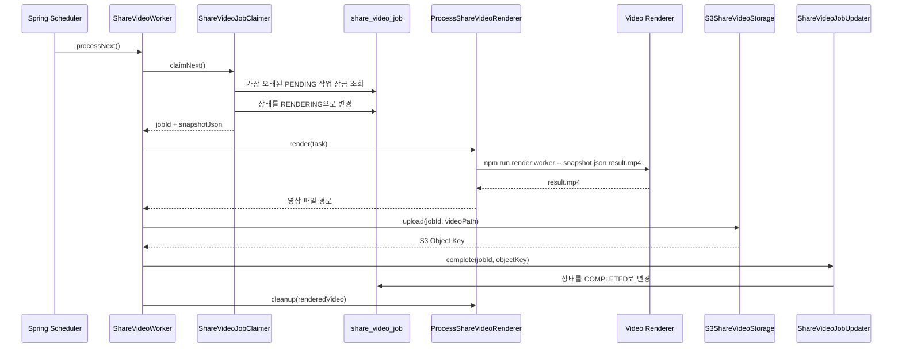
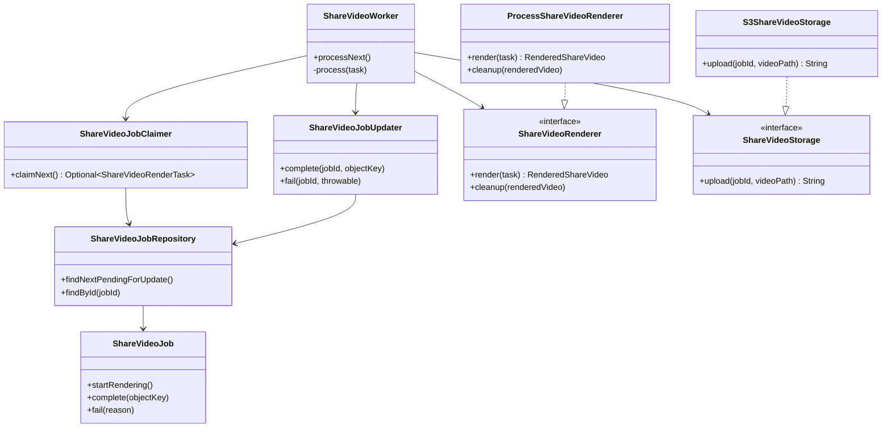

# 여행 타임라인 공유 영상

## 목적

여행 기록을 날짜순 국가 이동 경로로 변환하고, 영상 생성 요청 당시의 데이터를 스냅샷으로 저장한다. 이후 여행 기록이 수정되어도 이미 생성 요청한 영상의 입력은 바뀌지 않는다.

## 생성 API

```http
POST /api/v1/share-videos/travel-timeline
```

로그인 회원의 여행 기록을 시작일과 ID 순서로 조회한다. 국가 정류장이 두 개보다 적으면 `INSUFFICIENT_TIMELINE_STOPS` 오류를 반환한다.

성공 시 `202 Accepted`를 반환한다.

```json
{
  "data": {
    "jobId": 15,
    "status": "PENDING"
  }
}
```

## 상태 조회 API

```http
GET /api/v1/share-videos/{jobId}
```

현재 로그인 회원이 생성한 작업만 조회할 수 있다. 작업이 없거나 다른 회원의 작업이면 `SHARE_VIDEO_JOB_NOT_FOUND` 오류를 반환한다.

성공 시 `200 OK`를 반환한다.

```json
{
  "data": {
    "jobId": 15,
    "status": "RENDERING"
  }
}
```

클라이언트는 `PENDING` 또는 `RENDERING`인 동안 일정 간격으로 이 API를 다시 호출한다. `COMPLETED`가 되면 다운로드 URL을 요청하고, `FAILED`가 되면 재시도 화면을 표시한다.

## 다운로드 URL API

```http
GET /api/v1/share-videos/{jobId}/download-url
```

`COMPLETED` 작업에 대해 S3 조회용 Presigned URL을 발급한다. 백엔드가 영상 파일을 직접 전송하지 않으며, 클라이언트가 반환된 URL에서 영상을 다운로드한다.

성공 시 `200 OK`를 반환한다.

```json
{
  "data": {
    "jobId": 15,
    "downloadUrl": "https://example-bucket.s3.ap-northeast-2.amazonaws.com/share-videos/15/result.mp4?...",
    "downloadUrlExpiresIn": 300
  }
}
```

`downloadUrlExpiresIn`의 단위는 초다. 현재 `upload.policy.presigned-url-expiration` 설정을 사용하며 기본값은 5분이다. URL이 만료되어도 저장된 영상 파일은 삭제되지 않으므로 새 URL을 다시 요청할 수 있다.

작업 상태에 따른 응답은 다음과 같다.

| 작업 상태 | 결과 |
| --- | --- |
| `PENDING`, `RENDERING` | `409 Conflict`, `SHARE_VIDEO_NOT_READY` |
| `COMPLETED` | 다운로드 URL 반환 |
| `FAILED` | `409 Conflict`, `SHARE_VIDEO_GENERATION_FAILED` |

## 클라이언트 호출 흐름

1. 생성 API를 호출해 `jobId`를 받는다.
2. 상태 조회 API를 주기적으로 호출한다.
3. 상태가 `COMPLETED`이면 다운로드 URL API를 호출한다.
4. 반환된 URL로 영상을 다운로드하거나 공유한다.

## 스냅샷 구조

`share_video_job.snapshot_json`에 다음 구조를 저장한다.

```json
{
  "version": 1,
  "stops": [
    {
      "countryCode": "KR",
      "countryName": "대한민국",
      "visits": [
        {
          "visitId": 101,
          "startDate": "2026-03-10",
          "endDate": "2026-03-12"
        },
        {
          "visitId": 102,
          "startDate": "2026-04-01",
          "endDate": null
        }
      ]
    },
    {
      "countryCode": "GB",
      "countryName": "영국",
      "visits": [
        {
          "visitId": 103,
          "startDate": "2026-05-01",
          "endDate": "2026-05-07"
        }
      ]
    }
  ]
}
```

## 국가 변환 규칙

1. `COUNTRY` 지역은 해당 지역을 그대로 사용한다.
2. 시도와 시군구는 `Region.root`를 사용해 국가로 변환한다.
3. 연속된 대한민국 기록은 정류장 하나의 `visits`에 합친다.
4. 다른 국가가 사이에 있으면 대한민국을 새로운 정류장으로 만든다.
5. 다른 국가는 같은 국가가 연속되어도 방문 기록마다 별도 정류장으로 유지한다.

예를 들어 `서울 → 부산 → 영국 → 제주`는 `대한민국[서울, 부산] → 영국 → 대한민국[제주]`로 변환된다.

## 날짜 표시 규칙

- 방문이 한 번이고 종료일이 없으면 시작일만 표시한다.
- 방문이 한 번이고 종료일이 있으면 시작일과 종료일을 표시한다.
- 합쳐진 방문이 여러 개면 `첫 번째 시작일 외 N회`로 표시한다.
- 연도 타임라인은 첫 번째 방문의 시작일을 사용한다.

스냅샷에는 모든 방문 날짜를 보존하며, 표시 문구는 렌더러에서 만든다.

## 작업 상태

- `PENDING`: 영상 생성 대기
- `RENDERING`: 영상 생성 중
- `COMPLETED`: 영상 생성 완료
- `FAILED`: 영상 생성 실패

## 워커 실행 흐름

클라이언트의 생성 API 요청과 실제 영상 렌더링은 서로 다른 흐름으로 실행된다. 생성 API는 작업을 `PENDING`으로 저장한 뒤 바로 응답하고, 워커가 이후 작업을 처리한다.



렌더링 또는 업로드 중 예외가 발생하면 `ShareVideoJobUpdater.fail()`이 상태를 `FAILED`로 바꾸고 실패 이유를 최대 1,000자까지 저장한다.

## 워커 클래스 관계



인터페이스인 `ShareVideoRenderer`와 `ShareVideoStorage`가 실행 방법과 저장 장소를 감싼다. 그래서 워커는 Remotion 명령이나 S3 SDK 사용법을 알 필요 없이 `render()`와 `upload()`만 호출한다.

## 워커 설정

기본값은 워커 비활성화다. 개발 환경에서 아래 환경 변수로 활성화한다.

| 환경 변수 | 기본값 | 역할 |
| --- | --- | --- |
| `SHARE_VIDEO_WORKER_ENABLED` | `false` | 스케줄러와 워커 실행 여부 |
| `SHARE_VIDEO_WORKER_POLL_DELAY` | `3s` | 앞 실행이 끝난 후 다음 작업을 확인하기까지의 대기 시간 |
| `SHARE_VIDEO_RENDERER_DIRECTORY` | `../video-renderer` | `package.json`이 있는 Video Renderer 경로 |
| `SHARE_VIDEO_WORK_DIRECTORY` | 운영체제 임시 폴더 아래 `mapmory/share-videos` | 스냅샷 JSON과 결과 MP4 임시 저장 위치 |
| `SHARE_VIDEO_RENDER_TIMEOUT` | `10m` | 영상 하나의 최대 렌더링 시간 |
| `SHARE_VIDEO_NPM_COMMAND` | `npm` | Video Renderer를 실행할 명령 |

워커를 켜기 전에 Video Renderer의 의존성 설치와 S3 자격 증명 설정이 필요하다. 생성된 영상은 `share-videos/{jobId}/travel-timeline.mp4` Object Key로 업로드된다.

## 남은 운영 작업

백엔드 스냅샷에는 국가 대표 좌표를 저장하지 않는다. Video Renderer의 입력 변환기가 각 `countryCode`에 `longitude`, `latitude`를 보강한다.

현재 워커는 한 애플리케이션 인스턴스에서 영상 하나씩 처리한다. 여러 인스턴스가 실행될 때는 `FOR UPDATE SKIP LOCKED`로 같은 작업을 동시에 가져가지 않는다. 개발 환경에서 렌더링 시간, CPU, 메모리 사용량을 측정한 뒤 같은 인스턴스를 유지할지 전용 워커 인스턴스로 분리할지 결정한다.
