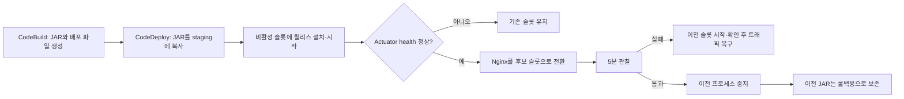

# 무중단 배포와 롤백

## 현재 상태

| 항목 | 상태 |
| --- | --- |
| 개발 서버 Blue-Green 수동 전환·롤백 | 완료, 기록 있음 |
| CodeDeploy 자동화 코드 | 저장소에 구현·커밋됨 |
| 자동화 코드의 EC2 적용·검증 | 아직 안 함 |
| 운영 배포 중 외부 요청 실패 수·중단 시간 측정 | 증거 부족, 추가 측정 필요 |

**자동화 코드를 커밋한 것과 서버에 적용해 검증한 것은 다릅니다.** 운영 적용 전에 개발 서버에서 반복 전환, 실패 복구, 외부 요청 측정을 먼저 해야 합니다.

## 배포 방식

한 EC2에서 Blue와 Green 앱을 별도 프로세스로 실행하고, Nginx가 한쪽 슬롯으로 요청을 보냅니다. 새 버전은 현재 요청을 받지 않는 슬롯에서 준비합니다.



| 고정 슬롯 | 앱 포트 | 관리 포트 | systemd 서비스 |
| --- | ---: | ---: | --- |
| Blue | 8080 | 8081 | `mapmory` |
| Green | 8090 | 8091 | `mapmory-green` |

슬롯 이름은 바뀌지 않습니다. Nginx가 Green으로 전환되면 Green이 활성이고 Blue가 비활성입니다. 다음 배포는 Blue에 새 버전을 준비합니다.

## 확정 정책

| 주제 | 정책 |
| --- | --- |
| DB 마이그레이션 | 후보 슬롯 시작 때 Flyway를 실행합니다. 기존 버전과 호환되는 추가·확장 변경만 함께 배포합니다. |
| 컬럼·테이블 삭제 | 팀이 별도 후속 변경으로 작성하고 배포합니다. 자동화가 사용 여부를 판단해 삭제하지 않습니다. |
| DB 롤백 | 앱 롤백 때 DB를 과거로 되돌리지 않습니다. 삭제·이름 변경은 이전 앱을 더는 되돌릴 필요가 없어진 뒤 별도 배포로 합니다. |
| 공유 영상 워커 | 두 API 슬롯에서는 끕니다. 렌더러 서버가 처리합니다. |
| 알림 워커 | 두 API 슬롯에서 켭니다. DB의 `FOR UPDATE SKIP LOCKED`로 작업을 나눕니다. FCM 중복 전송 가능성은 남으므로 검증이 필요합니다. |
| 자동 롤백 | 후보 Actuator health가 2초 간격으로 5회 연속 실패하면 복구합니다. 인증 기능 확인 실패는 관찰 중 롤백 요청 파일로 전달할 수 있습니다. |
| 이전 프로세스 | 전환 후 5분간 유지하고, 통과하면 중지합니다. 이전 JAR는 보존합니다. |
| 릴리스 보존 | 두 슬롯이 참조하는 JAR와 최근 성공 릴리스 3개를 보존합니다. 실패·미완료 릴리스는 7일 뒤 정리 대상입니다. |

Flyway 변경은 앱 배포 때 **새 Flyway migration 파일이 포함되어 있을 때만** 실행됩니다. 나중에 컬럼을 삭제하려면 팀이 별도 마이그레이션을 만들어 리뷰·배포해야 합니다. Flyway가 삭제 시점을 자동으로 판단하지 않습니다.

수동 Green 검증 때 사용한 `spring.flyway.enabled=false`는 API 응답 비교용 임시 설정이었습니다. 그 Green은 DB 마이그레이션을 적용하지 않았습니다. 자동화용 Blue·Green 서비스 설정은 Flyway를 켭니다.

## CodeDeploy 실행 순서

| 단계 | 파일 | 동작 |
| --- | --- | --- |
| 아티팩트 빌드 | `backend/buildspec.yml` | JAR, AppSpec, 스크립트, systemd 파일을 패키징 |
| 파일 배치 | `backend/appspec.yml` | JAR는 `/opt/mapmory/deploy-staging`, 서비스 파일은 `/etc/systemd/system`에 복사 |
| `BeforeInstall` | `bootstrap-blue-green.sh` | Nginx 포트로 활성 슬롯을 찾고 배포별 상태를 기록 |
| `AfterInstall` | `prepare-inactive-slot.sh` | 비활성 슬롯에 새 JAR를 보존·연결하고 시작해 health 확인 |
| `ApplicationStart` | `switch-traffic.sh` | Nginx 설정을 검사하고 후보 슬롯으로 전환. 실패하면 복구 |
| `ValidateService` | `validate-and-retain.sh` | 5분 관찰, 필요 시 복구, 통과 시 이전 프로세스 중지와 JAR 정리 |

주요 코드는 [AppSpec](/Users/one/wooteco/mapmory/2026-Mapmory/backend/appspec.yml), [배포 스크립트](/Users/one/wooteco/mapmory/2026-Mapmory/backend/scripts), [systemd 서비스](/Users/one/wooteco/mapmory/2026-Mapmory/backend/systemd)에 있습니다.

## JAR 저장·정리 예시

```text
/opt/mapmory/
├── deploy-staging/mapmory-backend.jar       # 다음 배포 때 덮어씀
├── slots/
│   ├── blue/current  -> releases/d-104      # 이전 버전, 롤백 후보
│   └── green/current -> releases/d-105      # 현재 활성 버전
└── releases/
    ├── bootstrap-blue-...                   # 초기 복사본, 자동 삭제 안 함
    ├── d-103                                # 최근 성공 3개에 포함되어 보존
    ├── d-104                                # Blue가 참조하므로 보존
    └── d-105                                # Green이 참조하므로 보존
```

- 성공 릴리스는 최근 3개와 두 슬롯이 가리키는 릴리스를 보존합니다. 나머지 성공 릴리스는 다음 성공 배포의 정리 단계에서 삭제됩니다.
- 실패·미완료 릴리스는 진단용으로 7일 보존하고, 슬롯이 더는 참조하지 않으면 다음 성공 배포 때 삭제합니다.
- bootstrap 릴리스와 배포 상태 파일·Nginx 백업은 현재 자동 정리하지 않습니다.

## 롤백 기준과 인증 확인

- 후보는 관리 포트의 `/actuator/health`로 확인합니다. 5회 연속 실패하면 이전 슬롯을 시작하고 health를 확인한 뒤 Nginx를 되돌립니다.
- 인증된 API 기능은 자동 health만으로 검증되지 않습니다. 5분 관찰 중 아이폰에서 실제 기능을 확인합니다.
- 기능 확인이 실패하면 다음 파일을 만들면 검증 스크립트가 롤백합니다.

```bash
sudo touch /var/lib/mapmory-deployments/<DEPLOYMENT_ID>/request-rollback
```

- 외부에서 인증 없이 호출할 수 있는 `/health`를 계속 요청해 전체 요청 수·실패 수·끊긴 시간을 별도로 기록합니다. 이 엔드포인트는 앱 응답 확인용이며 DB나 로그인 기능까지 증명하지 않습니다.

## 첫 자동화 배포 주의

CodeDeploy의 `ApplicationStop`은 새 아티팩트를 받기 전에 **이전 revision의 스크립트**로 실행됩니다. 현재 이전 스크립트는 Blue를 중지하므로 첫 자동화 배포에는 다운로드 시간까지 중단이 생길 수 있습니다. 첫 적용은 개발 서버에서 먼저 확인하고 무중단으로 기록하지 않습니다. [AWS CodeDeploy 후크 순서](https://docs.aws.amazon.com/codedeploy/latest/userguide/reference-appspec-file-structure-hooks.html)

## 개발 서버 리허설 기록

| 확인 항목 | 기록 |
| --- | --- |
| Blue·Green 인증 목록 요청 | 둘 다 HTTP 200, 조회 20건·전체 21건, 응답 동일 |
| Green 상태 | `/actuator/health` UP, deployment cache BYPASS |
| Green 전환 | Nginx 8080 → 8090, `nginx -t` 통과, 아이폰 동작 확인 |
| Blue 롤백 | 2026-11-10 01:59:51–02:02:20 KST, 절차 2분 29초 |
| 롤백 후 상태 | Blue 8080만 실행, `/health` HTTP 200, Green 중지 |
| 중단 시간 계측 | 안 함. 2분 29초는 롤백 절차 시간이지 서비스 중단 시간이 아님 |

당시 인스턴스는 메모리 3.7 GiB로 확장했습니다. 두 프로세스가 겹치는 피크 메모리와 자동화 스크립트는 아직 개발 서버에서 검증하지 않았습니다.

## 다음 확인

- [ ] 개발 서버에 코드를 적용하기 전 실제 Nginx 설정·환경 변수·서비스 파일을 대조한다.
- [ ] 첫 자동화 배포에서 구 `ApplicationStop`으로 생기는 중단을 측정한다.
- [ ] Blue↔Green 반복 전환, Flyway 호환 마이그레이션, 두 알림 워커 동시 실행을 검증한다.
- [ ] 5분 health 실패 롤백, 수동 롤백 요청, 이전 프로세스 재시작을 검증한다.
- [ ] 외부 연속 요청 측정 결과를 추가해 스프린트 완료 조건을 채운다.
