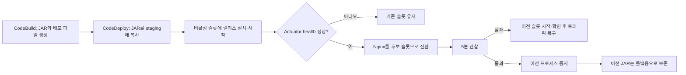

# 무중단 배포와 롤백

## 현재 상태

| 항목 | 상태 |
| --- | --- |
| 개발 자동 배포 | 2026-11-10 d-WPOME3DUL 성공, 외부 /health 318건 실패 0건 |
| 운영 캐시 준비 배포 | #678 반영 후 앱 health 200, deploymentcache BYPASS 확인 |
| 운영 Blue-Green 자동화 | 이 변경에서 코드 준비, 서버 적용·측정 전 |
| 운영 배포·롤백 실측 | 아직 수행 전, #676에서 진행 |

개발 환경 후속 리팩토링은 #675에서 진행합니다. 이번 운영 반영은 검증된 배포 코드를 가져오며 앱 기능·DB migration을 추가하지 않습니다.

## 배포 방식

한 EC2에서 Blue와 Green 앱을 별도 프로세스로 실행하고, Nginx가 한쪽 슬롯으로 요청을 보냅니다. 새 버전은 현재 요청을 받지 않는 슬롯에서 준비합니다.



| 고정 슬롯 | 앱 포트 | 관리 포트 | systemd 서비스 |
| --- | ---: | ---: | --- |
| Blue | 8080 | 8081 | `mapmory` |
| Green | 8090 | 8091 | `mapmory-green` |

슬롯 이름은 바뀌지 않습니다. Nginx가 Green으로 전환되면 Green이 활성이고 Blue가 비활성입니다. 다음 배포는 Blue에 새 버전을 준비합니다.

## 확정 정책

| 주제 | 정책 |
| --- | --- |
| DB 마이그레이션 | 후보 슬롯 시작 때 Flyway를 실행합니다. 기존 버전과 호환되는 추가·확장 변경만 함께 배포합니다. |
| 컬럼·테이블 삭제 | 팀이 별도 후속 변경으로 작성하고 배포합니다. 자동화가 사용 여부를 판단해 삭제하지 않습니다. |
| DB 롤백 | 앱 롤백 때 DB를 과거로 되돌리지 않습니다. 삭제·이름 변경은 이전 앱을 더는 되돌릴 필요가 없어진 뒤 별도 배포로 합니다. |
| 공유 영상 워커 | 두 API 슬롯에서는 끕니다. 렌더러 서버가 처리합니다. |
| 알림 워커 | 두 API 슬롯에서 켭니다. DB의 `FOR UPDATE SKIP LOCKED`로 작업을 나눕니다. FCM 중복 전송 가능성은 남으므로 검증이 필요합니다. |
| 자동 롤백 | 후보 Actuator health가 2초 간격으로 5회 연속 실패하면 복구합니다. 인증 기능 확인 실패는 관찰 중 롤백 요청 파일로 전달할 수 있습니다. |
| 이전 프로세스 | 전환 후 5분간 유지하고, 통과하면 중지합니다. 이전 JAR는 보존합니다. |
| 릴리스 보존 | 두 슬롯이 참조하는 JAR와 최근 성공 릴리스 3개를 보존합니다. 실패·미완료 릴리스는 7일 뒤 정리 대상입니다. |
| 서버 재부팅 | 개별 슬롯 서비스는 부팅 자동 시작에서 제외합니다. Nginx가 가리키는 슬롯을 부팅 서비스가 읽고 시작합니다. |
| 로그 | Blue와 Green은 각각 `/var/log/mapmory-blue/application.log`, `/var/log/mapmory-green/application.log`에 기록합니다. CloudWatch Agent도 두 파일을 모두 수집해야 합니다. |
| 실행 프로파일 | `/etc/mapmory.env`에 서버 환경에 맞는 `SPRING_PROFILES_ACTIVE=dev` 또는 `prod`를 설정합니다. 값이 없거나 다른 값이면 서비스가 시작되지 않습니다. |

Flyway 변경은 앱 배포 때 **새 Flyway migration 파일이 포함되어 있을 때만** 실행됩니다. 나중에 컬럼을 삭제하려면 팀이 별도 마이그레이션을 만들어 리뷰·배포해야 합니다. Flyway가 삭제 시점을 자동으로 판단하지 않습니다.

수동 Green 검증 때 사용한 `spring.flyway.enabled=false`는 API 응답 비교용 임시 설정이었습니다. 그 Green은 DB 마이그레이션을 적용하지 않았습니다. 자동화용 Blue·Green 서비스 설정은 Flyway를 켭니다.

## CodeDeploy 실행 순서

| 단계 | 파일 | 동작 |
| --- | --- | --- |
| 아티팩트 빌드 | `backend/buildspec.yml` | JAR, AppSpec, 스크립트, systemd 파일을 패키징 |
| 파일 배치 | `backend/appspec.yml` | JAR는 `/opt/mapmory/deploy-staging`, 서비스 파일은 `/etc/systemd/system`에 복사 |
| `BeforeInstall` | `bootstrap-blue-green.sh` | Nginx 포트로 활성 슬롯을 찾고 배포별 상태를 기록 |
| `AfterInstall` | `prepare-inactive-slot.sh` | 비활성 슬롯에 새 JAR를 보존·연결하고 시작해 health 확인 |
| `ApplicationStart` | `switch-traffic.sh` | Nginx 설정을 검사하고 후보 슬롯으로 전환. 실패하면 복구 |
| `ValidateService` | `validate-and-retain.sh` | 5분 관찰, 필요 시 복구, 통과 시 이전 프로세스 중지와 JAR 정리 |

배포 후 `prepare-inactive-slot.sh`가 `mapmory-active-slot.service`만 부팅 자동 시작 대상으로 두고,
개별 Blue·Green 서비스는 비활성화합니다. EC2 재부팅 시 부팅 서비스가 Nginx의 `proxy_pass`를 읽어
활성 슬롯만 시작하고 health를 확인합니다. 배포 대상 EC2의 systemd에는 CloudWatch Agent가 다음 두 로그를
모두 수집하도록 설정해야 합니다.

```text
/var/log/mapmory-blue/application.log
/var/log/mapmory-green/application.log
```

기존 수집 설정이 `/var/log/mapmory/application.log` 하나만 바라보면, 배포 전에 CloudWatch Agent 설정을
두 경로로 갱신하고 Agent 설정 검증·재시작을 마쳐야 합니다. 이 저장소는 서버의 Agent 설정을 직접 변경하지 않습니다.

주요 코드는 [AppSpec](/Users/one/wooteco/mapmory/2026-Mapmory/backend/appspec.yml), [배포 스크립트](/Users/one/wooteco/mapmory/2026-Mapmory/backend/scripts), [systemd 서비스](/Users/one/wooteco/mapmory/2026-Mapmory/backend/systemd)에 있습니다.

## JAR 저장·정리 예시

```text
/opt/mapmory/
├── deploy-staging/mapmory-backend.jar       # 다음 배포 때 덮어씀
├── slots/
│   ├── blue/current  -> releases/d-104      # 이전 버전, 롤백 후보
│   └── green/current -> releases/d-105      # 현재 활성 버전
└── releases/
    ├── bootstrap-blue-...                   # 초기 복사본, 자동 삭제 안 함
    ├── d-103                                # 최근 성공 3개에 포함되어 보존
    ├── d-104                                # Blue가 참조하므로 보존
    └── d-105                                # Green이 참조하므로 보존
```

- 성공 릴리스는 최근 3개와 두 슬롯이 가리키는 릴리스를 보존합니다. 나머지 성공 릴리스는 다음 성공 배포의 정리 단계에서 삭제됩니다.
- 실패·미완료 릴리스는 진단용으로 7일 보존하고, 슬롯이 더는 참조하지 않으면 다음 성공 배포 때 삭제합니다.
- bootstrap 릴리스와 배포 상태 파일·Nginx 백업은 현재 자동 정리하지 않습니다.

## 롤백 기준과 인증 확인

- 후보는 관리 포트의 `/actuator/health`로 확인합니다. 5회 연속 실패하면 이전 슬롯을 시작하고 health를 확인한 뒤 Nginx를 되돌립니다.
- 인증된 API 기능은 자동 health만으로 검증되지 않습니다. 5분 관찰 중 아이폰에서 실제 기능을 확인합니다.
- 기능 확인이 실패하면 다음 파일을 만들면 검증 스크립트가 롤백합니다.

```bash
sudo touch /var/lib/mapmory-deployments/<DEPLOYMENT_ID>/request-rollback
```

- 외부에서 인증 없이 호출할 수 있는 `/health`를 계속 요청해 전체 요청 수·실패 수·끊긴 시간을 별도로 기록합니다. 이 엔드포인트는 앱 응답 확인용이며 DB나 로그인 기능까지 증명하지 않습니다.

## 운영 첫 적용 — 머지 전 선행 조건

현재 운영은 캐시 준비 버전이 8080에서 실행 중이며, 기존 AppSpec의 `ApplicationStop`은 `systemctl stop mapmory`를 실행합니다. 새 AppSpec에서 훅을 제거해도 첫 적용에서는 **이전 성공 revision의 종료 훅**이 실행됩니다.

준비 배포 1회에만 중단을 허용했으므로 이번 PR을 곧바로 머지하지 않습니다. 추가 중단을 피하려면 아래 전환을 먼저 수행하고 결과를 확인해야 합니다.

1. 현재 준비 버전 JAR를 릴리스·슬롯 경로에 복사해 보존합니다. 기존 Blue는 계속 서비스합니다.
2. 이 PR의 Green 서비스와 실행 전 검사 스크립트를 서버에 준비하고, `prod`·공통 `BYPASS` 설정으로 Green을 시작합니다. Blue 서비스 파일은 이때 교체하지 않습니다.
3. Green 8090 앱 health, 8091 관리 health와 deploymentcache BYPASS를 확인합니다. 두 프로세스 메모리·DB 연결·워커 상태도 확인합니다.
4. API Nginx 설정만 백업하고 Green으로 전환합니다. 설정 검사·reload 후 외부 응답과 실제 앱을 확인하고, 기존 Nginx 워커의 요청 처리가 끝났는지 확인합니다.
5. 첫 파이프라인이 Blue를 종료해도 요청을 처리할 수 있도록 Green이 현재 정상 서비스 대상인 상태를 확인한 뒤 PR을 머지합니다. Green current 링크는 검증한 준비 버전 릴리스를 가리켜야 합니다.
6. 파이프라인은 이전 훅으로 비활성 Blue를 종료하고, Green을 유지한 채 새 Blue를 준비·전환·5분 관찰합니다. 외부 연속 요청은 수동 전환 전부터 자동 배포 완료까지 기록합니다.

이 전환은 아직 수행하지 않았습니다. 실행 명령과 복구 절차는 서버 설정을 대조한 뒤 단계별로 확인합니다. 이전 revision의 종료 훅은 서버에서 다시 읽어 실제 동작을 확인합니다. CodeDeploy 자동 롤백이 기존 방식 revision을 실행할 가능성도 있으므로 실패 시 Green 트래픽 유지와 수동 복구 절차를 먼저 준비합니다.

### 운영 환경 연결

- 프로필: `/etc/mapmory.env`의 `SPRING_PROFILES_ACTIVE=prod`.
- 캐시: `/etc/mapmory-deployment-cache.env`의 `DEPLOYMENT_CACHE_INITIAL_MODE=BYPASS`. 두 슬롯이 공통으로 읽습니다.
- Nginx: 현재 운영 API는 `/etc/nginx/conf.d/mapmory-api.conf`. 공통 코드는 `.conf` 파일 중 8080/8090 대상을 하나로 찾으며, 랜딩 파일은 수정하지 않습니다. 대상이 여러 개면 배포를 중단합니다.
- 로그: CloudWatch Agent에 Blue·Green 파일 수집 설정을 등록·검증해야 합니다. 이 PR은 Agent 설정을 자동 변경하지 않습니다.
- DB·워커: DB 연결 여유와 렌더러 처리 상태, 두 알림 워커의 동시 실행 조건은 머지 전에 확인해야 합니다.
- 운영 이전 정상 버전 백업: `/opt/mapmory/prod-before-blue-green-20261110-175746`.

## 개발 서버 리허설 기록

| 확인 항목 | 기록 |
| --- | --- |
| Blue·Green 인증 목록 요청 | 둘 다 HTTP 200, 조회 20건·전체 21건, 응답 동일 |
| Green 상태 | `/actuator/health` UP, deployment cache BYPASS |
| Green 전환 | Nginx 8080 → 8090, `nginx -t` 통과, 아이폰 동작 확인 |
| Blue 롤백 | 2026-11-10 01:59:51–02:02:20 KST, 절차 2분 29초 |
| 롤백 후 상태 | Blue 8080만 실행, `/health` HTTP 200, Green 중지 |
| 중단 시간 계측 | 안 함. 2분 29초는 롤백 절차 시간이지 서비스 중단 시간이 아님 |

위 표는 개발 수동 리허설 당시 기록입니다. 이후 개발 자동 배포 d-WPOME3DUL이 성공했고 5분 관찰 및 이전 Green 종료를 확인했습니다. 장애 복구 시나리오 전체가 검증됐다는 의미는 아닙니다.

## 다음 확인

- [ ] 개발 서버의 `/etc/mapmory.env`에 `SPRING_PROFILES_ACTIVE=dev`가 있고 운영 서버에는 `prod`가 있는지 확인한다.
- [ ] 배포 대상 EC2의 CloudWatch Agent가 Blue·Green 로그 파일을 모두 수집하는지 확인한다.
- [ ] 개발 서버에 코드를 적용하기 전 실제 Nginx 설정·환경 변수·서비스 파일을 대조한다.
- [ ] 운영 첫 적용 전에 Green 선전환·기존 요청 drain·복구 절차를 확인해 구 `ApplicationStop`으로 추가 중단이 생기지 않도록 준비한다.
- [ ] Green 전환 후 EC2 재부팅 리허설을 해 Nginx 활성 슬롯만 시작되는지 확인한다.
- [ ] Blue↔Green 반복 전환, Flyway 호환 마이그레이션, 두 알림 워커 동시 실행을 검증한다.
- [ ] 5분 health 실패 롤백, 수동 롤백 요청, 이전 프로세스 재시작을 검증한다.
- [ ] 외부 연속 요청 측정 결과를 추가해 스프린트 완료 조건을 채운다.
