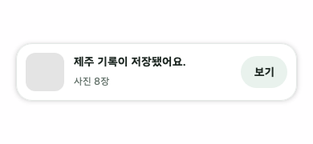
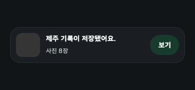

# 사진 업로드와 백그라운드 복구

## 확인한 지연 경로

- `PhotoLibrary.ios.kt`는 추천 미리보기에도 고품질·네트워크 허용 요청을 사용한다. iCloud에만 있는 사진이 많으면 미리보기 준비 자체가 느릴 수 있다.
- `UploadingTripRecordRepository`는 원본 읽기, presigned URL 발급, PUT을 사진별로 순차 실행한다. 원본 품질과 메모리 상한을 유지하는 대신 다운로드와 업로드 대기가 합산된다.
- 기존 iOS 원본 로딩은 모든 청크를 ByteArray로 복사한 뒤 다시 합쳤다. 이번 변경은 PhotoKit의 파일 쓰기를 사용하고, 재시도 시 내려받은 원본을 재사용한다. 성공한 기록의 원본 캐시는 정리한다.
- iOS에서 완료된 PUT은 파일 기반 전송 장부로 재사용한다. 재실행 시 이미 완료된 사진은 원본 읽기·presign·PUT을 건너뛴다.

실기기 속도를 측정하지 않았으므로 개선 배수나 소요 시간 감소를 보장하지 않는다. 다음 성능 작업은 `미리보기 / iCloud 원본 준비 / presign / PUT / 기록 저장` 시간을 분리 측정하고, 보이는 미리보기 우선 로딩 및 최대 두 장의 원본 준비·전송 겹치기를 검토하는 것이다. 전체 원본을 한꺼번에 메모리에 적재하지 않는다.

## 실행과 복구

- 대기 기록은 API 환경별 앱 내부 파일에 원자적으로 저장한다. 미리보기 바이트는 JSON에서 제외한다.
- Android는 앱과 Worker가 하나의 컨테이너를 공유하고, WorkManager의 foreground 작업이 진행 알림을 표시한다. Activity가 끝나도 컨테이너를 닫지 않는다. 선택한 사진 URI의 읽기 권한을 영속화하고 프로세스 재생성 시 대기 기록을 복구한다. 업로드 성공 후 영속 권한을 해제한다.
- iOS PUT은 background URLSession의 파일 기반 작업이다. 전송 파일과 작업 설명을 남겨 시스템 재실행 시 연결한다. Swift AppDelegate가 UI 없이도 저장 큐를 초기화한다.
- iOS 사용자 강제 종료는 전송 지속을 보장할 수 없다. 다음 앱 실행에서 대기 작업을 복구한다. iCloud에서 아직 가져오지 못한 원본 준비도 OS 실행 시간 제한을 받는다.
- Android 설정의 강제 중지도 작업 지속 대상이 아니다. 일반적인 화면 종료·최근 앱 제거·OS 프로세스 정리와 구분한다.
- 서버 저장 요청 후 응답이 불확실한 작업은 자동으로 다시 생성하지 않는다. 목록을 확인하도록 실패 상태를 표시한다. 완전한 자동 복구에는 서버의 idempotency key 지원이 필요하다.
- Android 프로세스 종료 시 아직 서버 기록으로 확정하지 않은 사진 PUT은 다시 수행할 수 있다. HTTP PUT의 중간 바이트부터 재개하는 구현은 아니다.

## 알림과 화면

- Android 알림 권한은 첫 대기 작업이 생겼을 때 요청하며, 거부해도 업로드는 유지한다. 앱이 백그라운드이고 알림 설정이 켜져 있을 때 진행 알림과 완료 알림을 제공한다. WorkManager의 필수 foreground service 알림은 별개다.
- iOS는 첫 업로드 시 권한을 요청한다. 백그라운드에서 진행 구간별 알림을 갱신하고, 서버 기록 저장이 끝나면 완료 알림을 보낸다. 권한 창이나 앱 전환기로 잠시 비활성화된 상태는 백그라운드로 취급하지 않는다. 연속적인 시스템 진행 막대나 Live Activity는 아니다.
- 앱 안에서는 화면을 이동해도 저장 완료 카드를 표시한다. 앱을 떠나면 카드를 지우고, 백그라운드에서 완료된 작업의 카드를 복귀 시 다시 표시하지 않는다. 다른 기록 작성 중에는 `보기`를 숨겨 작성 내용을 보존한다.

완료 카드의 라이트, 다크 테마 렌더링 테스트 결과다. 사진이 없는 테스트 데이터를 사용했으며 실기기 캡처와 구분한다.

- 목록의 원형 진행 표시를 없애고 기록 정보 아래에 작은 `약 n초 남음`을 표시한다. 추정 전에는 `남은 시간 계산 중`, 대기에는 `업로드 대기 중`, 서버 저장 단계에는 `기록 저장 중`을 표시한다.
- 추정치는 경과 시간과 완료된 사진 수 기반 진행률을 사용한다. 사진 크기와 iCloud·네트워크 상태가 달라지면 변동하며, 첫 사진 완료 전에는 추정하지 않는다.

## 실기기 검증 항목

1. 로컬 사진과 iCloud 전용 사진을 나눠 1장·10장·100장으로 단계별 시간과 최대 메모리를 측정한다.
2. 홈 이동, 화면 잠금, 최근 앱 제거, OS 프로세스 정리, 사용자 강제 종료를 구분해 복구와 서버 기록 수를 확인한다.
3. 비행기 모드 전환, 만료된 presigned URL, 사진 접근 권한 철회, 저장 공간 부족을 확인한다.
4. 알림 허용·거부, 전경·배경에서 진행 및 완료 알림을 확인한다.
5. 기록 생성 응답 직전 종료 후 중복 기록이 자동 생성되지 않는지 확인한다.

실기기에서 종료 지속·iCloud 성능·알림 동작을 검증하기 전에는 배포 검증 완료로 간주하지 않는다.

## 플랫폼 근거

- [Apple: background URLSession](https://developer.apple.com/documentation/foundation/urlsessionconfiguration/background(withidentifier:))
- [Apple: background file transfers](https://developer.apple.com/documentation/foundation/downloading-files-in-the-background)
- [Android: long-running workers](https://developer.android.com/develop/background-work/background-tasks/persistent/how-to/long-running)

## 이번 변경 검증 결과

- JVM 테스트 278개 통과, 실패·오류·건너뜀 0개.
- Android Debug Kotlin 컴파일 통과.
- Xcode iOS Simulator Debug 전체 앱 빌드 통과. Kotlin 프레임워크 링크와 Swift AppDelegate를 포함한다.
- 실제 기기의 iCloud 속도와 알림 권한별 표시 결과는 미검증이다.

### 2026-11-05 실제 서버 업로드 중 종료, 재실행

개발 서버에서 테스트 이미지 12장, 앱 전환기 종료 검증에서는 40장을 담은 대기 기록을 준비하고, 앱의 실제 presign, 사진 PUT, 기록 생성 경로를 실행했다. 사진 선택 UI가 아닌 영속 저장 큐에 테스트 작업을 넣어 복구 경로를 검증했다.

| 환경 | 종료 시점과 방법 | 재실행 결과 | 중복 확인 |
| --- | --- | --- | --- |
| Android 16 에뮬레이터 | 실제 업로드 7%에서 `am force-stop` | 대기 작업 복구 후 사진 12장 저장 완료, 대기 큐 0개 | 개발 API 목록과 상세 재조회에서 해당 테스트 기록 1개, 사진 12장 |
| iPhone 17, iOS 26.5 Simulator | 사진 PUT 1장 완료, 다음 전송 진행 중 `simctl terminate` | 재실행 후 나머지 업로드와 기록 저장 완료, 대기 큐와 전송 장부 0개 | 한 번 더 종료, 재실행한 일지 목록에서 해당 기록 1개, 사진 12장 |
| Galaxy S25 Ultra, Android 17 실기기 | 실제 업로드 15%에서 `am force-stop` | 재실행 후 사진 12장 저장 완료, 대기 큐 0개 | 개발 API 목록과 상세 재조회에서 해당 테스트 기록 1개, 사진 12장 |
| iPad Air 4, iPadOS 26.6 실기기 | 사진 PUT 1장 완료, 다음 전송 진행 중 `SIGKILL` | 재실행 후 업로드와 기록 저장 완료, 대기 큐와 전송 장부 0개 | 별도 서버 목록 재조회는 수행하지 않음 |
| iPad Air 4, iPadOS 26.6 실기기, 사용자 앱 전환기 종료 | 사진 40장 중 PUT 12장 완료, 다음 전송 진행 중 사용자가 위로 밀어 종료, 프로세스 종료 확인 | 약 30초 뒤에도 대기 작업 유지, 재실행 후 나머지 전송과 기록 저장 완료, 대기 큐와 전송 장부 0개 | 별도 서버 목록 재조회는 수행하지 않음 |

모든 테스트는 서버 기록 생성 요청 전 종료했다. 앱이 종료된 동안에도 완료된다는 검증은 아니며, 재실행 후 복구와 저장을 확인한 결과다. 앱 전환기 종료 테스트는 사용자의 실제 제스처로 진행했으며, 재실행 후 약 174초 만에 대기 큐와 전송 장부가 모두 비워졌다. 서버 기록 생성 응답 직전 종료는 별도 확인이 필요하다.

Galaxy 실기기에서 `UploadNotificationLifecycleTest` 2개도 통과했다. 전경과 앱 내 화면 이동 시 완료 알림 억제, 백그라운드 알림, 설정 비활성화 시 알림 억제, 영속 대기 작업 복구를 확인했다. 테스트 중 변경한 사진 알림 설정은 원래 값으로 복원했다.
