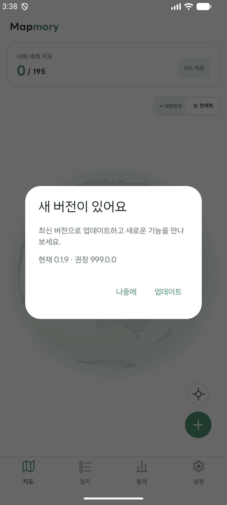

# 권장 업데이트와 업데이트 알림

## 앱 안 권장 안내

Firebase Remote Config의 기존 최소 지원 버전 매개변수와 같은 규칙으로, 플랫폼별 권장 버전 매개변수를 사용합니다. 설치 버전보다 높은 값이면 앱을 열었을 때 업데이트 안내가 표시됩니다. `android_dev_`와 `ios_dev_` 키는 개발 빌드에서만 읽습니다.

| 구분 | Android | iOS |
| --- | --- | --- |
| 운영 최소 지원 버전 | `android_min_supported_version` = `0.1.8` | `ios_min_supported_version` = `1.2.4` |
| 개발 최소 지원 버전 | `android_dev_min_supported_version` = `0.0.0` | `ios_dev_min_supported_version` = `0.0.0` |
| 운영 권장 버전 | `android_recommended_supported_version` | `ios_recommended_supported_version` |
| 개발 권장 버전 | `android_dev_recommended_supported_version` | `ios_dev_recommended_supported_version` |

이번 화면 검증에서는 Remote Config의 운영 권장 버전 값을 조회하거나 변경하지 않았습니다. 안내를 비활성화하려면 권장 버전을 현재 설치 버전 이하로 설정하고, 공지를 시작할 때는 해당 플랫폼 스토어에 공개된 버전을 설정합니다. 최소 지원 버전은 기존처럼 필수 업데이트 차단에만 사용합니다.
권장 버전은 플랫폼별 앱 버전 형식으로 입력하고, 업데이트 버튼이 열 스토어에 실제 공개된 버전을 사용합니다. 저장소의 현재 앱 버전은 Android `0.1.9`, iOS `1.2.5`이며, 다음 버전을 안내할 때는 스토어 공개 상태를 확인한 뒤 값을 설정합니다.

## 푸시 알림

Firebase Cloud Messaging 주제로 앱 업데이트 소식을 보냅니다.

| 대상 | FCM 주제 |
| --- | --- |
| 스토어 앱 | `mapmory-app-update` |
| Android debug, iOS Debug | `mapmory-app-update-dev` |

Firebase Console에서 알림 메시지를 만들고 해당 주제를 대상으로 발송합니다. 알림 권한이 꺼진 기기에는 OS 알림이 보이지 않을 수 있지만, 앱 안 권장 안내는 별도로 동작합니다. 자동 발송이나 백엔드 변경은 포함하지 않았습니다.

## Firebase 및 Apple 설정

- Firebase 프로젝트에서 Cloud Messaging을 켜고 iOS 앱의 APNs 인증 키를 업로드해야 iOS 기기 푸시를 받을 수 있습니다.
- iOS Debug 및 Release 앱 서명 프로파일에 Push Notifications entitlement가 포함되어야 합니다.
- iOS Internal과 Android Internal 빌드는 현재 Firebase 설정 파일/초기화를 제외하므로 업데이트 Remote Config와 푸시를 사용할 수 없습니다. 개발 동작 확인에는 Android debug 및 iOS Debug 구성을 사용합니다.

## 권장 업데이트 화면 확인

2026-10-29 Android 에뮬레이터 Debug 빌드에서 현재 버전보다 높은 권장 버전을 로컬 테스트 값으로 적용해 화면을 확인했습니다. 표시되는 현재 버전은 `0.1.9`이며, `999.0.0`은 화면 확인용 값입니다. Firebase Remote Config 운영값은 변경하지 않았습니다. 화면에는 `새 버전이 있어요`, 현재·권장 버전, `나중에`, `업데이트` 동작이 표시됩니다.

실제 안내를 시작하려면 해당 플랫폼의 `*_recommended_supported_version`을 스토어에 공개된 버전으로 설정합니다. 권장 버전이 현재 설치 버전보다 높으면 안내가 표시되고, `0.0.0`처럼 현재 버전 이하이면 표시되지 않습니다. 이 캡처는 안내 화면의 시각 확인 결과이며, 운영 Remote Config 값, 스토어 이동, 실제 Remote Config 배포는 검증 범위에 포함하지 않았습니다.
